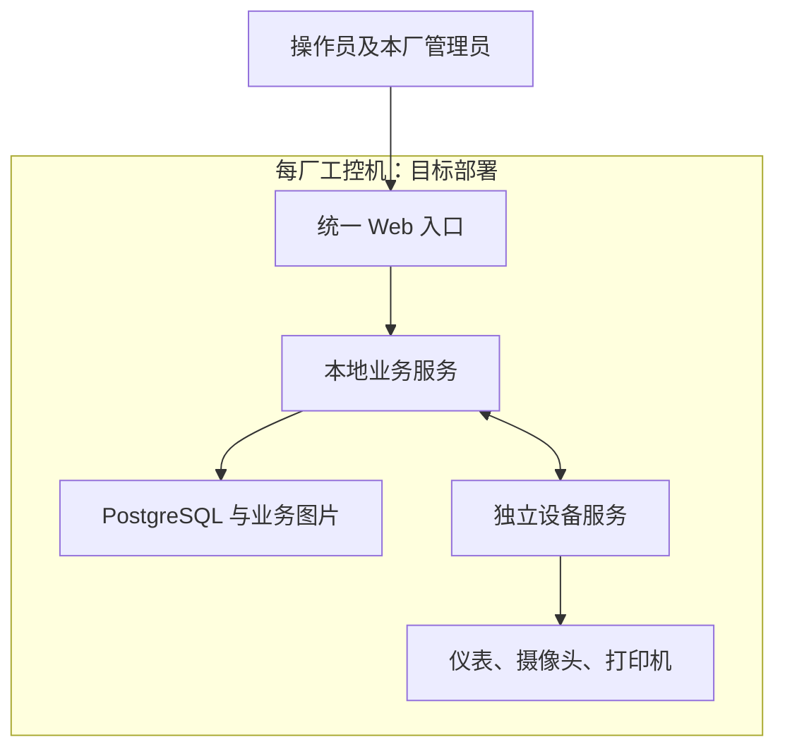

# 架构入口

当前采用[ADR 0023](../adr/0023-standalone-site-baseline.md)：两个厂区各自独立运行，本厂业务服务（内嵌 Web）、设备服务和 PostgreSQL 三个核心服务同机部署。中心暂缓，设备维护最终纳入本地业务服务。该目标已确认，自治及维护整合仍待实施。

数据库按[ADR 0024](../adr/0024-postgresql-only.md)统一使用 PostgreSQL，单库收敛已有[交付记录](../requirements/postgresql-only-delivery.md)。

| 材料 | 用途 |
| --- | --- |
| [当前规格](../requirements/standalone-site-spec.md) | 改造范围、代码差距及验收条件 |
| [基线索引](../development-baseline.md) | 旧架构和业务规格的效力 |
| [既有业务设计](backend-business-loop-design.md) | 复用业务模型与接口；历史阶段限制以顶部说明为准 |
| [旧中心同步设计](local-first-sync-design.md) | 已有实现的参考资料；中心功能暂缓，不是当前施工方案 |
| [历史与交付索引](../history/README.md) | 软件与现场验证事实 |

保留现有设备通信、人工确认、证据和打印核实规则。Agent 负责设备，host-collector 只负责可选宿主机监控，二者不混用。安装与维护整合完成前，现有独立维护服务作为过渡保留。
