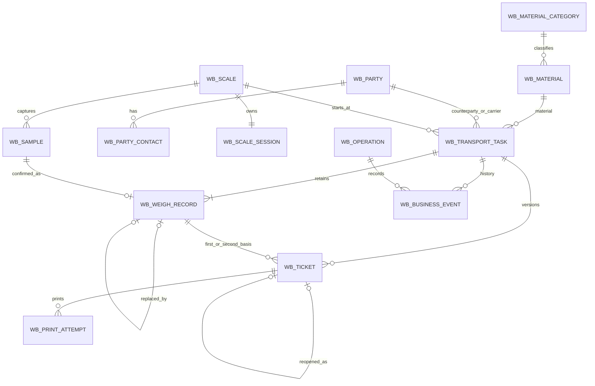
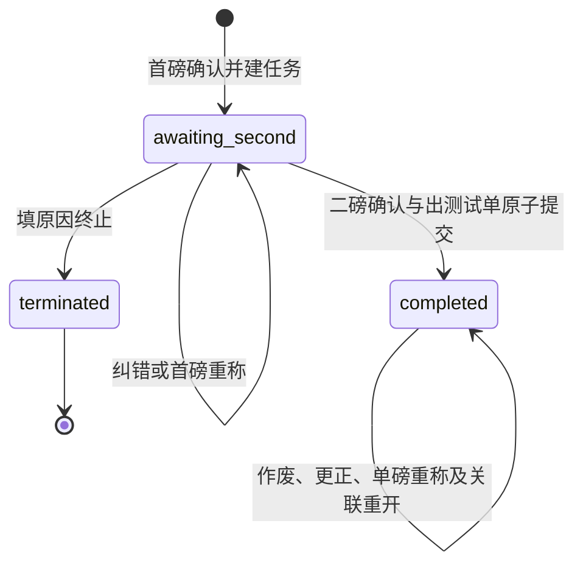

# 服务端业务闭环：数据库与接口设计

> **2026-10-22 效力：历史阶段规格，业务模型按后续规则复用。** 仅测试数据／系统内模拟／浏览器打印等为当时阶段边界；后续使用 Agent 契约、按厂区限制同车任务，本地正常时断互联网可办理。单据版本、审计、幂等和快照继续保留，数据库按 ADR 0024。当前依据见 [ADR 0023](../adr/0023-standalone-site-baseline.md)及[基线索引](../development-baseline.md)；下文历史正文保留。

> 数据库范围更新（2026-10-22）：[ADR 0024](../adr/0024-postgresql-only.md) 已取代本文的 SQLite 支持、双库迁移与兼容测试条款；当前开发和验收统一使用 PostgreSQL。其余条款按当前开发基线适用。

状态：2026-10-18 已按 B01–B07 实现服务端测试业务及前端接入；实际验证与环境限制见 [实施记录](../requirements/backend-business-loop-delivery.md)。真实设备及正式业务仍未实现。范围及验收见 [Spec](../requirements/backend-business-loop-spec.md)，交付顺序见 [计划](../requirements/backend-business-loop-plan.md)。

## 1. 现状与设计边界

实施前已有认证、角色菜单、用户、字典、文件、审计等模块。当前新增称重业务表与 API，并在 Bearer 后按真实业务动作授权；称重页面权限来自服务端 capabilities，业务数据由 API 管理。旧通用 mock 工具保留给原有页面，不参与称重业务授权。

沿用 handler/service/repository/model 分层及 app 装配。新增 `internal/weighing`，内部管理资料、测试采集、运输、单据和打印用例，按职责拆文件；事务落在其 repository，避免现在就建立跨模块事务框架。复用 `internal/audit.RecordOn` 与 HTTP envelope，不调整既有 JWT、登录和用户管理契约。

开发、测试与部署数据库统一为 PostgreSQL。单厂区、单地磅，任务记录地磅身份，不预建多租户、ERP、库存或现场设备协议表。

## 2. 通用数据规则

| 项目 | 设计 |
| --- | --- |
| 表与主键 | 新业务表使用 `wb_` 前缀；PostgreSQL BIGINT identity 主键；API id 使用与现有接口相同的数字类型 |
| 时间 | 采集、确认、出单、打印分别记录；UTC 保存、RFC3339 传输；业务日期按 Asia/Shanghai 转为 UTC 半开区间过滤 |
| 公共字段 | 资料表有 create_time、update_time、create_by、update_by、version；业务事实有 create_time、actor_id、actor_name，不物理删除 |
| 状态 | 资料 enabled 用 0/1；业务状态使用明确字符串及 CHECK，不混用任务完成、单据有效、打印成功 |
| 重量 | 数据库 BIGINT 保存“千分之一吨”的整数，字段后缀 `_milli_tonne`；Go int64 计算，不经 float64 四舍五入 |
| 重量接口 | 用吨制十进制字符串，如 `"30.125"`、`"9"`；最多三位小数；拒绝非有限数、指数写法、超精度、溢出和非正毛皮重。净重、差额由服务端计算 |
| 取舍 | 整数避免浮点精度误差；这是吨的定点编码，不改回 kg 业务录入，不等同设备原单位 |
| 快照 | PostgreSQL JSONB，应用校验同一 schemaVersion；只存嵌套证据与历史快照，查询／过滤／汇总字段独立列出 |
| 删除 | 资料只有从未引用时可删除；事实、单据、事件、操作结果不提供删除／清空业务接口；不对证据使用级联删除 |

### 2.1 编号

`wb_number_sequence` 以 `(kind, business_date)` 为主键，`next_value` 为正整数；kind 包括 task、test_ticket、material、party。任务 `RW+YYYYMMDD+流水`，测试单 `CS+YYYYMMDD+流水`；资料编码建议 `WL`／`ZT` 加同样日期流水。流水至少四位，超过 9999 自然扩展，不截断，不用 COUNT+1。

在业务写事务内原子增量并取号，业务表另设 UNIQUE。失败事务未发布的编号可回滚；已提交、已作废或已终止对象的编号永不回收，不承诺连续。日期由服务端生成，不接受客户端指定编号。正式单号格式本阶段不实现。

## 3. ER 图

图展示主要关系。编号表不参与业务关联；sample 创建时任务可以尚不存在；operation 可以只有失败事件而无成功业务对象。

## 4. 表字段与约束

以下省略第 2 节的公共字段，`?` 表示可空。FK 默认 RESTRICT；资料被停用和历史事实不可删除是业务规则，不能仅依赖 FK。

### 4.1 基础资料（5 张表）

| 表 | 核心字段 | 约束和用途 |
| --- | --- | --- |
| wb_material_category | id、name、enabled、version | 名称非空；已被物料或业务快照引用时不可删除，可停用 |
| wb_material | id、code、name、category_id?、spec、enabled、remark、version | code UNIQUE；name 非空；category FK；同名不同规格允许；单位固定吨，不增可变单位列 |
| wb_party | id、code、name、short_name、nature、is_supplier、is_customer、is_carrier、phone、address、credit_code、enabled、remark、version | code UNIQUE；nature enterprise/individual；至少一个身份为 1；名称不唯一；企业信用代码选填 |
| wb_party_contact | id、party_id、name、phone、purpose、remark、is_default | party FK；默认联系人部分唯一索引；存在联系人必须恰有一个默认项，由整体保存事务校验；省略联系人即空集合 |
| wb_scale | id、code、name、enabled | code UNIQUE；初始化唯一地磅身份，不在此模拟正式设备协议或真实量程 |

资料被引用包括任务引用、业务历史快照和已归档事件中的引用。资料删除事务检查这些使用记录，不因任务后来换了资料就允许删除原引用。类别历史引用在结构化资料快照中保留 categoryId，检查使用记录时一并核对。

主体联系人按主体整体保存并校验归属，禁止把另一个主体的联系人 id 移入本主体；移除联系人不改写任务联系人快照。停用资料不供新任务／纠错新增选择，既有任务可沿用原资料完成回磅。移除主体身份前，检查未结束任务是否仍需要该供收／承运身份；检查与更新在同一写事务中完成。

### 4.2 现场会话及测试采集（2 张表）

| 表 | 核心字段 | 约束和用途 |
| --- | --- | --- |
| wb_scale_session | scale_id PK/FK、holder_user_id?、holder_name?、client_id?、token_hash?、generation、expires_at?、version、conditions_version、test_conditions_snapshot | 每磅仅一行；空闲时持有者为空；接管和重新获得会话递增 generation；客户端只收到随机 token，不传数据库锁；当前模拟条件与版本保存在本行 |
| wb_sample | id、scale_id、owner_user_id、client_id、session_generation、task_id?、target_record_id?、business_hash、stage、kind、plate、source、weight_milli_tonne、captured_at、expires_at、stable、device_ok、evidence_snapshot、plate_evidence、conditions_version、invalidated_at? | source 本阶段只能 simulated；weight>0；stage first/second，kind gross/tare；称重确认通过 record.sample_id UNIQUE 消费一次；重称采样绑定原任务和被替代记录 |

测试采集入口由服务端配置 `weighing.test_mode` 显式启用，生产配置默认关闭；关闭时禁止创建／确认测试采样，但允许有权限查询原测试历史。默认空业务库；地磅身份和菜单角色属于基础配置，非测试业务种子。

浏览器发送吨制模拟重量、稳定／故障／抓拍场景及内置图片 preset，服务端生成 sample 与证据快照。preset 必须映射服务端版本化的内置示例图片，快照含 assetKey、assetVersion、内容摘要、视角、采集时间、重量、候选／人工确认车牌；不接受任意 URL 冒充现场抓拍。不通过通用文件模块存放本阶段图片，避免系统文件清理破坏测试证据；示例资产发布后保留已有版本。

样本绑定持有者、客户端、会话代次、车牌、阶段和任务／首磅草稿摘要。首磅允许先采重再补资料：资料未齐时先绑定车牌和方向，确认时校验核对后的资料版本；已齐时绑定完整资料摘要。识别证据显式记录 source、scenePlate、candidate 与 confirmedPlate，手填来源不伪造候选；客户端观察时间仅作附加字段，服务端采集时间为权威。确认接口带核对过的业务摘要及 sampleId；发生切车、资料变更、重新采集、失稳、超时、故障或模拟设置变化时旧样本失效。模拟条件变更通过服务端入口递增 conditions_version，不能只改浏览器布尔值。稳定／超时等测试条件不构成真实设备判据。

2026-10-19 用户修订：采样不设时间有效期，取消 `weighing.sample_ttl`；操作会话默认 `weighing.session_ttl: 60s`；浏览器按租期四分之一续租，最长间隔 15 秒，仅为本阶段可配置测试参数。确认时再验证当前条件、业务绑定、会话有效性、持有者及代次。接管后旧 token 与旧 sample 立即失效。取得有效地磅会话不代表可以操作任意任务。

### 4.3 运输任务与称重事实（2 张表）

| 表 | 核心字段 | 约束和用途 |
| --- | --- | --- |
| wb_transport_task | id、task_no、mode、plate、direction、status、scale_id、material_id、party_id、carrier_id?、business_snapshot、current_first_record_id?、current_second_record_id?、version、completed_at?、terminated_at?、terminate_reason? | task_no UNIQUE；mode=test；direction inbound/outbound；status awaiting_second/completed/terminated；plate 在 awaiting_second 下部分唯一；方向创建后锁定 |
| wb_weigh_record | id、task_id、sample_id、stage、kind、weight_milli_tonne、captured_at、confirmed_at、scale_id、replaces_record_id?、retained_record_id?、reason?、same_load_confirmed、other_basis_confirmed、actor_id、actor_name、evidence_snapshot、plate_evidence | sample_id UNIQUE；replaces_record_id 非空时 UNIQUE；task FK；正重量；事实只追加，不覆盖；保留采集时原车牌及识别依据 |

`business_snapshot` 包含资料 id、编码、名称、物料规格及分类 id／名称、主体性质、供收方及承运方、运输联系人、司机与电话、备注、人工确认车牌。任务保存当前业务资料快照；每次纠错将完整前后值写入业务事件。司机与主体联系人分别保存，不自动建档。

首磅创建任务和记录在同一事务完成，对外不存在空任务。为解决插入顺序，current_first_record_id 在 DDL 可空，事务提交前必须赋值；详情不得把这个技术可空态作为正常状态。记录 FK 指向任务，记录表增加 UNIQUE(task_id, id)，任务当前指针 `(id, current_first_record_id)`／`(id, current_second_record_id)` 以组合 FK 引用记录 `(task_id, id)` 防止串任务；单据采用同样组合 FK。stage 和 kind 对应关系由 service 校验并在 repository 提交前重检。

任务不另存毛／皮／净三套可变合计；列表从当前指针取原始组合。首次和二次依据各自保留确认时间，替换首次不改二次日期。`retained_record_id` 仅在已有另一磅时必填；只有首磅时重称不要求虚构另一磅。同车唯一性基于规范化车牌而非原始输入空格，复用现有普通／新能源校验。

### 4.4 各版单据（1 张表）

| 字段组 | 字段与约束 |
| --- | --- |
| 标识和版本 | id、ticket_no UNIQUE、task_id FK、revision、previous_ticket_id?；UNIQUE(task_id, revision)，previous_ticket_id 非空时 UNIQUE，关联同一 task |
| 性质和状态 | mode=test、status valid/void；对 status=valid 的 task_id 建部分唯一索引 |
| 历史依据 | first_record_id、second_record_id、business_snapshot、basis_snapshot、snapshot_schema_version；两个 record 必须属于本任务且 stage/kind 正确 |
| 原始重量 | original_gross_milli_tonne、original_tare_milli_tonne；均>0，毛>皮；原始净重按差值计算 |
| 最终重量 | final_gross_milli_tonne、final_tare_milli_tonne；均>0，毛>皮；最终净重与调整差额只读计算，不接受客户端差额 |
| 调整与来源 | gross_source、tare_source 为 collected/manual；adjustment_remark、adjusted_by?、adjusted_at?；值不同则 manual，空备注用默认文案 |
| 出单及作废 | issued_at、issued_by、issuer_name、voided_at?、voided_by?、void_reason?；作废必须填写原因 |

业务快照包含当版车牌和全部运输资料；basis_snapshot 包含两条记录原始证据、时间、操作者及替代信息。只保存原始依据链接不够：查询和打印按当版快照读取，后续资料更正、称重指针变化不能反向修改旧单。采集值不变的人工重开不生成新 record。

单据业务内容写入后不可 UPDATE／DELETE；仅可通过作废命令设置状态、作废人员时间原因。打印状态来自独立打印记录，不写回重量快照。不增可编辑单据通用接口。

重开从当前版本链末端的作废单产生新版本，previous_ticket_id 指向它；不得从较早作废版本分叉。新单须使用任务当前有效两磅且依据有效。已作废单不占车牌，任务仍 completed。

### 4.5 操作结果、历史、打印与编号（4 张表）

| 表 | 核心字段 | 约束和用途 |
| --- | --- | --- |
| wb_operation | id、actor_id、request_id、command、request_hash、status、task_id?、ticket_id?、result_snapshot、error_snapshot?、committed_at | UNIQUE(actor_id, request_id)；成功／业务拒绝结果随事务提交；不持久暴露半完成任务；requestId 不是 HTTP 跟踪 id |
| wb_business_event | id、operation_id?、task_id?、ticket_id?、sample_id?、resource_type、resource_id?、action、reason?、before_snapshot?、after_snapshot?、actor_id、actor_name、occurred_at | 追加保存成功动作、人工核对声明及被业务拒绝的异常尝试；资料引用 id 保留；资料事件通过 resource_type／resource_id 定位；不复用可清空的系统操作日志作为唯一业务证据 |
| wb_print_attempt | id、ticket_id、request_id、attempt_no、intent initial/retry/reprint、status initiated/unknown/printed/failed、reason?、initiated_at、initiated_by、resolved_at?、resolved_by?、resolution_source、closed_at?、close_reason? | UNIQUE(ticket_id, attempt_no)；结果来源 operator；发起、反馈及其更改均追加业务事件；旧状态变更历史可追溯；closed_at 只表示本次尝试已结束处置，不代表打印成功 |
| wb_number_sequence | kind、business_date、next_value | 复合主键及并发原子取号，见 2.1 |

成功业务命令的事实、指针、单据、operation、business_event 以及 `audit.RecordOn` 同一事务提交，任何持久化失败全部回滚。系统操作日志清空不影响业务历史。

业务拒绝如原始毛皮异常，在锁定并复核后只提交 rejected operation 与异常 event，不写有效二磅、不完成任务、不出单；返回对应业务错误。数据库故障／事务失败不能承诺已记下异常，以既有 503／500 合约响应，并通过原 requestId 查询或显式重试。不把拒绝操作通过成功审计 Recorder 伪记成成功。

### 4.6 索引与迁移注意

- 任务：task_no 唯一；`plate WHERE status='awaiting_second'` 唯一；`(status, create_time, id)`、`(plate, create_time, id)`。
- 记录：sample_id 唯一，replaces_record_id 非空唯一；`(task_id, confirmed_at, id)`；二次确认日期索引支持原始列表。
- 单据：ticket_no、(task_id, revision) 唯一，task_id 的 valid 部分唯一；`(issued_at, id)`、`(task_id, issued_at, id)`，按实际查询增加物料／主体组合索引。
- 样本：(scale_id, captured_at)、(owner_user_id, client_id, captured_at)；事件：(task_id, occurred_at, id)、(ticket_id, occurred_at, id)；打印：(ticket_id, attempt_no)。
- PostgreSQL 使用唯一、CHECK 和 FK 约束；跨行状态、资料身份、记录归属及业务证据规则仍需事务内验证。不能以只做 `SELECT exists` 代替唯一约束。
- 新 migration 按依赖建资料、任务、采集／记录、单据及保障表；循环引用通过 PostgreSQL 后置 FK 处理。Goose Down 先清空任务当前记录指针，再按依赖移除单据／事件／记录／采样／任务，须验证非空测试库回退；不得修改历史 migration 或启用 AutoMigrate。

## 5. 状态转换

| 动作 | 前置条件 | 原子结果／失败表现 |
| --- | --- | --- |
| 首磅确认 | 权限、有效会话与样本、人工核对、资料启用且身份匹配、无同车未结束任务 | 创建 awaiting_second 任务、首条 record 和结果；任一步失败无新任务 |
| 二磅确认 | awaiting_second、当前首磅有效、样本阶段和毛皮正确、原始／最终净重均>0 | 新 record、任务 completed、首版有效测试单一起提交；失败保持待回磅 |
| 纠错／终止 | awaiting_second、version 匹配、原因非空；纠错锁定方向、校验新车牌唯一 | 改当前资料快照并保存前后值，或永久终止并释放车牌 |
| 未出单重称 | awaiting_second、同装载状态声明、样本符合目标磅 | 新记录替代首磅，保留旧记录；任务仍待回磅 |
| 单据作废 | 目标 valid、原因非空、version／目标状态匹配 | 原单 void，任务仍 completed，不创建新任务，不占回磅车牌 |
| 已出单后重称 | completed、无有效单、末版已作废、无同车其他未结束任务、同装载状态及另一磅有效声明 | 仅新增指定记录并更新当前指针；旧单保持不变，尚无新有效单 |
| 更正重开 | completed、无有效单、从末版作废单发起、原始依据有效、原因非空 | 新版单据与当前业务快照一起提交；失败保持无有效单，允许继续办理 |

出单前的人工最终值随二磅请求提交，不单独创建“人工称重”。重称后重开表单默认采用最新有效原值，显式展示旧版最终值；人工沿用或重新调整必须由操作员确认，不默默套用旧差额。

原始毛皮无效时禁止重开，即使最终值已调到合法；不能自动交换毛皮。重开不允许更改方向、原始采集时间／图片。旧单纠正车牌时同时检查是否会与其他未结束任务冲突，不能以资料更正规避跨趟重称限制。

## 6. 事务、幂等与并发

### 6.1 一次业务命令

1. Handler 复用 Bearer 主体、校验业务权限、解析字符串重量及 DTO；actor／姓名／确认时间由服务端生成。
2. Repository 开启事务，先以 `(actor_id, requestId)` 查重并比较规范化 command／payload 的 hash；已有同内容结果立即返回，不同内容复用同 key 拒绝。此时不因旧样本到期、旧会话失效或 version 已变化而否定原成功结果。
3. 未找到原结果时，带采集命令先锁定地磅会话行，再锁任务；纯更正命令锁任务。同 key 并发请求在取得相关锁后再次查重，然后才验证会话代次、样本、version 和业务状态。需要修改的资料／末版单据在事务中重读；首磅等无任务对象的动作通过会话行串行化，打印通过单据行串行化；跨不同对象误用同 key 由 operation 唯一约束拒绝并回滚，回滚后查询原 key 判定同内容回放或 key 冲突。
4. Service 的纯规则产生待写结果，Repository 基于锁内重读的数据完成提交前规则校验；校验与写入不拆成两个事务，不接受客户端“当前状态”。
5. 写事实、唯一约束、快照、业务事件、成功审计和 operation，提交后返回对象 id、状态、version 及服务端计算重量。

Service 不依赖 GORM：Store 提供 `ConfirmFirst`、`ConfirmSecond`、`Reweigh`、`VoidTicket`、`ReopenTicket` 等业务原子方法，并承载锁内所需规则调用；不暴露 Begin／Commit，也不暴露通用 CRUD 让调用者拼事务。纯规则函数可由 service/repository 共用，避免两套业务规则。

PostgreSQL 用任务／会话行锁加唯一约束，不自动重放业务事务。锁顺序统一为会话（若需）→任务→资料→单据→编号，批量资料按 id 顺序处理。无 Redis、分布式锁或自动补偿出单 worker。

同车新任务创建与旧任务重称都先占用同一地磅会话，并在事务内复查同车未结束任务；新任务唯一索引兜底。仅人工更正旧单不需要占用地磅，也不释放／抢占新任务。资料维护和任务提交都必须在事务内同步校验主体身份与引用，PostgreSQL 锁同一资料行，防止停用／删身份与新引用竞态。

### 6.2 提交结果未知

前端在首次点击前生成 requestId 并保存待决请求；断网、刷新或回包丢失保留它。`GET /operations/:requestId` 仅查当前登录者的操作，返回 committed/rejected；尚无已提交行返回 not_found，**不代表已证实未执行**，可能仍在事务中。

查询不创建业务，不能自动新建 requestId 或改用新样本重放。用户显式重试使用同 key／同 payload：已提交则返回旧结果；未提交但仍占锁则等待有界窗口后 503；完全未执行时重新验证原采样，过期则业务拒绝并要求重新采集、新请求。仅明确拒绝／未执行且人工重新核对后，才开启新确认。退出登录后不把另一账号的未决请求当作本账号结果。

### 6.3 会话范围

clientId 为每个独立工作台实例生成，不把 JWT 当作操作会话；同账号两个窗口也不能同时持有采集权。空闲、到期、主动释放可重新取得；未到期时需显式接管及原因，写业务事件。采集、确认和重称均验证 token/generation，心跳到期后的旧样本不得继续使用。车辆等待装卸时释放会话，任务仍待二磅。

## 7. API 清单与 DTO

新增业务前缀 `/api/weighing`，不变更 `/api/system`、`/api/auth` 等既有接口。响应继续 `{code,message,data}`；分页为 `{records,total,page,pageSize}`，page 从 1 开始，pageSize 1–500。错误复用现有约定：校验／业务冲突走既有业务错误 envelope，鉴权 401、授权 403、缺失 404、临时不可用 503；冲突不静默覆盖。CSV 成功走文件流，失败仍按既有 JSON 错误合约。

### 7.1 资料与工作台

| 方法与相对路径 | 用途／主要输入 |
| --- | --- |
| GET /material-categories、/materials、/parties | 分页／筛选，支持名称编码、状态、分类或业务身份；工作台候选只返回启用且匹配的资料 |
| GET /materials/:id、/parties/:id | 资料详情，主体包含联系人 |
| POST /material-categories、/materials、/parties | 新增，code 自动生成；联系人随主体整体提交 |
| PUT /material-categories/:id、/materials/:id、/parties/:id | 修改，带 version；主体现有联系人 id 必须属于该主体 |
| PATCH /material-categories/:id/status、/materials/:id/status、/parties/:id/status | 启停，带 version |
| DELETE /material-categories/:id、/materials/:id、/parties/:id | 仅从未引用的资料可删除，带 version；禁止绕过历史引用检查 |
| GET /capabilities | 当前用户真实业务 permissionCodes、testMode 和地磅基础信息；不修改既有 auth/me 响应 |
| GET /scales/:id/session | 查询占用状态，不返回其他人的 token |
| POST /scales/:id/session/acquire、/renew、/release、/takeover | 当前工作台会话；acquire 用 clientId，其他带 token；takeover 必填原因 |
| GET /tasks/active?plate=… | 规范化车牌定位未结束任务，返回当前依据、version |
| POST /test/samples | 模拟采集，带会话 token、车牌、stage、taskId?、模拟条件、业务摘要 |
| POST /test/samples/:id/invalidate | 失稳／条件变化／取消核对时废弃样本，只有持有者可操作 |
| POST /test/conditions | 修改本会话模拟条件并递增版本，失效旧样本；不能改真实用户权限或绕过账号 |

普通资料写接口复用 version／审计；返回新增对象及编码，避免前端自行推算。测试入口需 testMode 和 `weighing:simulate`；不提供清空共享业务库的 UI/API，旧演示“重置整库”按钮在后端模式移除。

### 7.2 任务、单据、历史及导出

| 方法与相对路径 | 用途／主要输入 |
| --- | --- |
| POST /tasks/first-confirmation | requestId、scaleId、sampleId、sessionToken、业务资料、人工核对声明；原子首磅建任务 |
| POST /tasks/:id/second-confirmation | requestId、version、sampleId、sessionToken、人工核对声明、finalWeights?；原子二磅出单 |
| POST /tasks/:id/corrections | requestId、version、业务资料、reason；仅未出单任务，方向不可变 |
| POST /tasks/:id/reweighs | requestId、version、targetRecordId、sampleId、sessionToken、sameLoadConfirmed、otherBasisValid、reason |
| POST /tasks/:id/termination | requestId、version、reason；不可恢复 |
| POST /tickets/:id/void | requestId、reason；仅有效单 |
| POST /tickets/:id/reopen | requestId、taskVersion、业务资料、basisValid、finalWeights、reason；从末版作废单关联重开 |
| GET /tasks、/tasks/:id | 分页与完整详情，包含当前依据及历次记录／事件，不依赖浏览器缓存 |
| GET /originals | 每个已具备有效两磅的任务一行，含 currentTicketStatus；未有效出单仍可查依据，但不计汇总 |
| GET /tickets、/tickets/:id | 每版单据一行，详情按快照返回，包含链关系及打印记录 |
| GET /tasks/:id/events | 历史分页，支持称重与作废重开追溯 |
| GET /operations/:requestId | 当前用户查询提交结果，无已提交结果不推断失败 |
| GET /originals/summary、/tickets/summary | 原始／最终汇总，仅当前有效单关联任务 |
| GET /originals/export、/tickets/export | CSV 明细，覆盖全部筛选结果 |
| GET /originals/summary/export、/tickets/summary/export | CSV 汇总，使用与对应汇总查询相同过滤条件 |

确认 DTO 的 checked 项至少包括车牌、业务资料、重量、证据、车辆完全上磅；声明绑定 sample 与业务摘要。重称另确认相同装载状态和另一有效磅。这些是操作员声明，不能声称系统通过勾选就验证了现实车况。

重量示例：`finalWeights: {gross: "30.125", tare: "9", remark: "磅精度调整"}`；响应重量字段同样使用吨制字符串。列表沿用日期、车牌、任务／单号、方向、物料、供收方与状态筛选；查询稳定使用时间及 id 排序，不只按同秒时间。

### 7.3 打印

| 方法与相对路径 | 用途 |
| --- | --- |
| GET /tickets/:id/preview | 只读当版快照与明确测试／作废标记；预览不增加打印次数 |
| POST /tickets/:id/print-attempts | requestId、intent、reason?；先保存 initiated，再由前端打开浏览器打印 |
| POST /print-attempts/:id/result | requestId、printed/failed/unknown、reason?；记录 operator 来源，不接受 device 来源 |
| GET /tickets/:id/print-attempts | 历次尝试和人工反馈 |

发起后浏览器关闭或断开但无明确反馈，仍视为结果待核实；刷新也不得恢复为“未打印”。仅明确失败且未出纸允许 retry；已打印或不能排除出纸，须 reason 非空，以 reprint 发起。attempt_no 计全部尝试，reprintCount 只计去重成功的 reprint 发起，不把明确失败重试计作补打。

部分唯一索引限制同单最多一个 `closed_at IS NULL` 且 status 为 initiated/unknown 的未决尝试。补打前操作员核实：已确认成功／失败则记录真实反馈并关闭原尝试；仍无法排除出纸时，显式说明原因并确认补打，在同一事务关闭原尝试、保留 unknown 状态及原因，再创建 reprint，不伪记 printed。不能自动结束未知尝试或自动重打。作废单只读查看／预览带作废标记，不发起新打印，历史打印保留。

## 8. 权限与前端接入

新增业务授权查询复用 user_role→role→role_menu→menu 的启用／未删除关系，不用“visible=1”作为授权必要条件；隐藏菜单仍可承载动作码。现有 menu_type 仅 DIR/MENU/LINK，不为动作码引入新枚举：使用隐藏 MENU 项，真实可见业务菜单仍供侧栏。新增业务能力接口返回当前有效代码，服务端每次动作校验，不把前端列表或角色名称作为授权证据。

已有角色赋权和用户角色分配入口也只有 Bearer 鉴权；若只保护新业务 API，普通登录者仍可通过旧入口给自己赋权，不能验收为真实授权。B01 需同时补齐直接管理授权和账号的最小入口校验：角色／角色菜单写动作使用既有 `system:role`，菜单写动作使用 `system:menu`，用户创建／修改／删除／启停／分配角色／重置密码使用 `system:user`。保持原路径、DTO、成功响应、JWT 和角色分配规则；无对应权限返回既有 403 合约。当前用户修改自己密码／头像仍按既有本人接口办理，不要求用户管理权限。此项是落实已确认真实权限的必要依赖，不扩展为全系统权限重构；需要验证操作员不能自授权限或重置管理员密码。

| 权限组 | 建议代码与用途 |
| --- | --- |
| 资料查询／维护 | `weighing:master:read`、`weighing:master:write` |
| 业务查询／确认 | `weighing:read`、`weighing:confirm` |
| 异常动作 | `weighing:correct`、`weighing:adjust`、`weighing:reweigh`、`weighing:terminate`、`weighing:void`、`weighing:reopen` |
| 打印／导出／接管 | `weighing:print`、`weighing:reprint`、`weighing:export`、`weighing:takeover` |
| 测试采集 | `weighing:simulate`，必须同时 testMode=true |

操作员默认拥有资料查询、业务查询确认和约定异常／打印／导出／接管权限；测试环境另授 simulate。管理员具备资料维护及现有授权管理能力，可通过既有角色分配获得业务权限；保留已有 ADMIN 行为，新增菜单 seed 为其明确关联新权限，不依赖魔法角色名绕过。人工最终值不同于原值时除 confirm/reopen 外还需 adjust。更正重开涉及资料变化需 correct；补打同时需要 print 和 reprint。

前端新增 `src/api/weighing.ts`；保留现有 pages/components/types/store 组织。后端业务页面使用 capabilities 判断按钮和路由，但所有动作仍由服务端裁决；不在本阶段顺手替换整个系统所有 mock 权限或重构既有系统路由。

`weighing-store` 保留 UI 草稿、核对步骤和当前会话；任务、资料、单据来自 API，不再复制整库并在前端执行权威状态转换。新浏览器 key 与旧演示 key 分离，旧 key 原样保留，不自动读入新 API 页面。演示岗位切换和全库重置不再影响真实业务；切换身份需真实登录。操作后重取服务端对象，version 冲突刷新并重新核对。

日期沿用现有模拟口径：原始列表按当前有效二磅确认日期，单据列表按各版 issued_at；汇总只计当前有效单，不把旧作废版或重开重复累计。该口径用于操作查询，不宣称是客户结算报表归属。跨日任务保留两次真实时间，不补造同日数据。

## 9. 迁移与实现边界

当前 schema 最新 00009、seed 最新 00005；实现时重新核对后新增版本，仅维护 PostgreSQL schema/seed 版本。建议首批 schema 00010 起、seed 00006 起，按计划依赖拆分；本设计不占号、不预写空迁移。

schema 创建业务表，seed 仅增加业务菜单／权限、操作员角色定义和唯一地磅身份，不自动建测试任务、示例单据或新账号；不自动给所有已有用户授予操作员角色。空库也不自动生成演示交易。真实设备阶段再设计独立可信采集适配器、正式单号及现场参数，测试样本与单据不能原地改成正式性质。

本阶段不复用 `host-collector` 做现场 Agent，不增加 WSS 实现，不改写已发布 migration，不提前构建设备上报队列。正式证据文件与备份恢复方案须在设备阶段补充，不能把内置示例资产方案当作真实图片存储实现。
