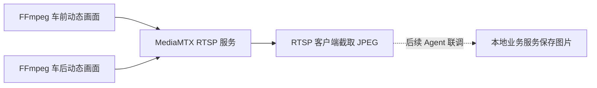
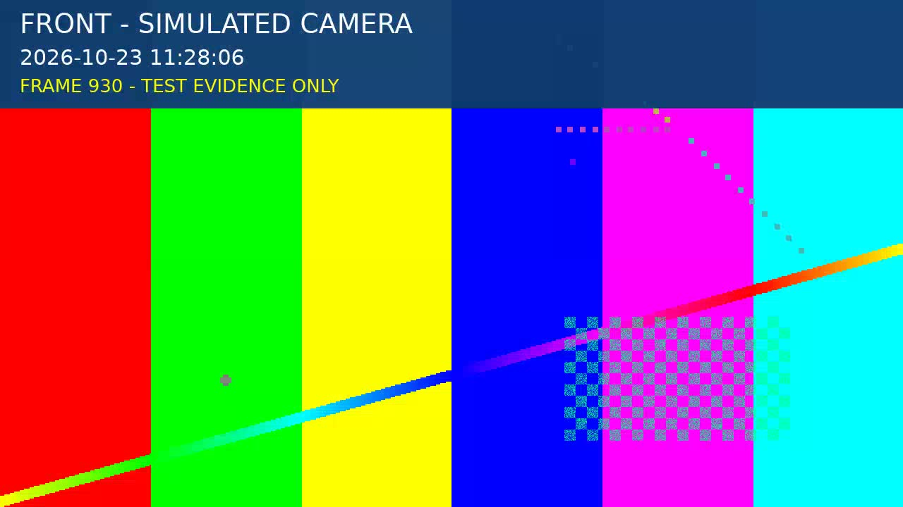
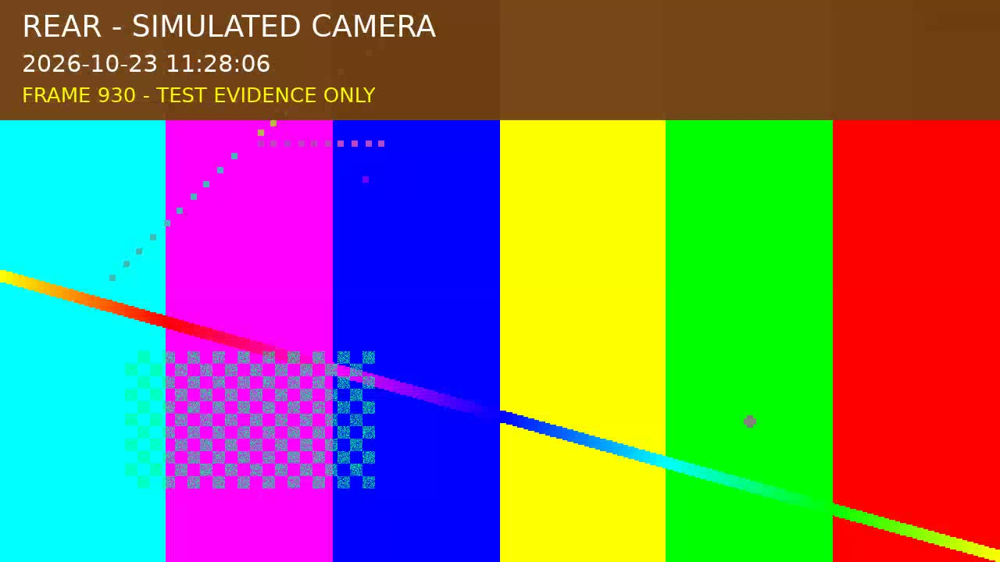

# 用 FFmpeg 和 MediaMTX 搭建双路 RTSP 模拟摄像头：部署、截帧与故障恢复实录

日期：2026-10-23。本文记录一次 Linux amd64 环境中的实际部署，主机地址使用文档示例值，截图来自部署后的真实 RTSP 截帧。

开发地磅系统时，重量仪表已能上报数据，现场摄像头的型号和接口参数还没有确定。为了提前验证 RTSP 取图，我们用 FFmpeg 实时生成两路动态画面，通过 MediaMTX 发布，供设备 Agent 后续接入。

最终得到两个可以持续读取的地址，分别模拟车前和车后摄像头。我们完成了容器部署、跨主机截帧、图像更新和单路故障恢复检查。Agent 的图片上传、仪表与抓拍关联以及真实车牌识别，仍需在后续联调中验证。

## 一、先明确各组件的职责

FFmpeg 负责生成、编码和推送画面，MediaMTX 负责接收推流并提供 RTSP 读取地址。客户端按需连接流，解码一帧并输出 JPEG。MediaMTX 官方提供了 [FFmpeg 发布 RTSP 的用法](https://mediamtx.org/docs/publish/ffmpeg)。



这种安排可以分别停止任一路推流、重启流服务，也便于后续将模拟地址换成现场摄像头地址。

部署使用三个容器：`mediamtx`、`front`、`rear`。三者共用包含 FFmpeg 的 MediaMTX 镜像，宿主机只需准备 Docker、Compose 和字体文件。Agent 如果运行在其他机器上，仍需在它自己的运行环境中安装 FFmpeg。

## 二、用动态画面观察每次抓拍

每路画面都包含方向、当前北京时间和递增帧号。车前使用蓝色标题栏；车后使用棕色标题栏，并将背景左右翻转。这样可以直接判断视角是否接反，以及两次抓拍是否取得了不同画面。





画面同时标记 `SIMULATED CAMERA` 和 `TEST EVIDENCE ONLY`。这里没有车辆录像或车牌素材，适合验证取图通道；车牌识别需要另外准备素材和识别服务。

## 三、准备目录、镜像和字体

本文示例使用 `/data/camera`，地址使用 `192.0.2.10`。**复现前将所有示例 IP 替换为部署机器实际持有、客户端能够访问的局域网 IPv4 地址。**

目录结构如下：

```text
/data/camera/
├── .env
├── compose.yaml
├── mediamtx.yml
├── publish.sh
└── fonts/
    └── DejaVuSans.ttf
```

先创建目录并复制字体。以下字体路径来自本次部署的 Linux 主机；其他发行版应先找到实际可用的字体文件，再复制到相同目标位置。

```bash
mkdir -p /data/camera/fonts
cd /data/camera
cp /usr/share/fonts/truetype/dejavu/DejaVuSans.ttf fonts/DejaVuSans.ttf
```

本次验证版本为 MediaMTX `v1.21.2`、FFmpeg `8.1.2`。镜像通过摘要固定，避免后续拉取同一标签时版本改变。在 `.env` 中填写：

```dotenv
CAMERA_BIND_IP=192.0.2.10
CAMERA_IMAGE=registry-1.docker.io/bluenviron/mediamtx@sha256:c0feb4acc548d5f410d57d9046f62dfa355e2abc4098f5243de9e86430c77a95
```

MediaMTX 的 `1-ffmpeg` 镜像变体包含 FFmpeg，见[官方安装说明](https://mediamtx.org/docs/kickoff/install)。这里记录的是本次实测镜像摘要。

部署时还遇到一次镜像拉取问题：宿主机配置的 Docker 镜像加速站返回 403。随后使用显式的 `registry-1.docker.io` 地址成功拉取同一官方镜像，保留了宿主机原有 Docker 配置。遇到类似情况，可以先区分是加速站拒绝访问，还是上游镜像、网络或鉴权有问题。

## 四、配置只提供 TCP RTSP 的流服务

将下面内容保存为 `mediamtx.yml`：

```yaml
logLevel: info
rtsp: true
rtspAddress: :8554
rtspTransports: [tcp]
rtmp: false
hls: false
webrtc: false
srt: false
moq: false
api: false
metrics: false
pprof: false
playback: false

paths:
  front:
    source: publisher
    overridePublisher: false
  rear:
    source: publisher
    overridePublisher: false
```

两个 path 分别接收对应推流。`overridePublisher: false` 避免另一个发布者直接替换已在线的同名流。其他视频协议在本次实验中关闭，宿主机只发布 TCP 8554 端口。相关选项见 [MediaMTX 配置参考](https://mediamtx.org/docs/references/configuration-file)。

这份配置用于可信局域网的模拟联调，没有配置访问账号。若部署环境需要访问控制，应结合该环境配置认证和网络访问范围。

## 五、生成带时间与帧号的两路画面

将下面内容保存为 `publish.sh`：

```sh
#!/bin/sh
set -eu

view=${1:?Use front or rear}
case "$view" in
  front) label='FRONT - SIMULATED CAMERA'; color='0x103c72'; transform='null' ;;
  rear) label='REAR - SIMULATED CAMERA'; color='0x714016'; transform='hflip' ;;
  *) echo 'Use front or rear' >&2; exit 2 ;;
esac

# Draw live wall time and an increasing frame counter, so successive captures
# can be distinguished. A one-second GOP keeps new RTSP readers responsive.
filters="$transform,drawbox=x=0:y=0:w=iw:h=154:color=$color@0.95:t=fill,drawtext=fontfile=/fonts/DejaVuSans.ttf:text='$label':fontcolor=white:fontsize=38:x=28:y=18,drawtext=fontfile=/fonts/DejaVuSans.ttf:text='%{localtime}':fontcolor=white:fontsize=30:x=28:y=70,drawtext=fontfile=/fonts/DejaVuSans.ttf:text='FRAME %{n} - TEST EVIDENCE ONLY':fontcolor=yellow:fontsize=26:x=28:y=112"

exec ffmpeg -nostdin -hide_banner -loglevel warning \
  -re -f lavfi -i 'testsrc2=size=1280x720:rate=15' \
  -vf "$filters" -an -c:v libx264 -threads 2 \
  -preset ultrafast -tune zerolatency -pix_fmt yuv420p \
  -b:v 1200k -maxrate 1500k -bufsize 1500k -g 15 -keyint_min 15 -sc_threshold 0 \
  -f rtsp -rtsp_transport tcp "rtsp://mediamtx:8554/$view"
```

这里使用 `testsrc2` 实时生成动态测试画面，`drawbox` 绘制标题背景，`drawtext` 叠加文字、时间和帧号；滤镜参数可查 [FFmpeg 官方说明](https://ffmpeg.org/ffmpeg-filters.html)。

几个参数会直接影响联调体验：

| 参数 | 本次用途 |
| --- | --- |
| `-re` | 按输入时间节奏生成并推送，保持接近实时的帧率 |
| `1280x720:rate=15` | 生成 720p、15 fps 画面 |
| `-g 15` | 在当前编码设置下使用约一秒的关键帧间隔，方便新客户端开始解码 |
| `-tune zerolatency` | 使用 x264 的低延迟调优配置 |
| `-rtsp_transport tcp` | 推流走 TCP，与本次 RTSP 服务配置一致 |
| `-threads 2` | 限制编码线程数 |

新客户端取得第一帧的耗时还包括连接、媒体探测和解码，不能只根据关键帧间隔推算。本次实际截帧大约需要 2.3～3.1 秒。

## 六、用 Compose 管理三个进程

将下面内容保存为 `compose.yaml`：

```yaml
name: weighbridge-camera-sim

x-common: &common
  image: ${CAMERA_IMAGE:?Set CAMERA_IMAGE in .env}
  restart: unless-stopped
  logging:
    driver: json-file
    options:
      max-size: "10m"
      max-file: "3"

services:
  mediamtx:
    <<: *common
    ports:
      - "${CAMERA_BIND_IP:?Set CAMERA_BIND_IP in .env}:8554:8554"
    volumes:
      - ./mediamtx.yml:/mediamtx.yml:ro

  front:
    <<: *common
    depends_on:
      - mediamtx
    entrypoint: ["/bin/sh", "/camera/publish.sh", "front"]
    environment:
      TZ: CST-8
    volumes:
      - ./publish.sh:/camera/publish.sh:ro
      - ./fonts:/fonts:ro

  rear:
    <<: *common
    depends_on:
      - mediamtx
    entrypoint: ["/bin/sh", "/camera/publish.sh", "rear"]
    environment:
      TZ: CST-8
    volumes:
      - ./publish.sh:/camera/publish.sh:ro
      - ./fonts:/fonts:ro
```

`TZ: CST-8` 在本次镜像中用于显示北京时间，采用 UTC+8 的 POSIX 时区写法。字体通过目录挂载提供。服务使用 `unless-stopped` 重启策略，日志按每容器 10 MB、3 份轮转。

`depends_on` 规定启动顺序，并不代表 MediaMTX 已经就绪。推流进程若在服务尚未监听时退出，会由容器重启策略重新启动；部署后仍需确认两个 path 都已经在线。

完成配置后执行：

```bash
cd /data/camera
docker compose config --quiet
docker compose pull
docker compose up -d
docker compose ps
docker compose logs --tail=60
```

日志应出现 `front`、`rear` 两个 path 在线及 H.264 轨道信息。此时可读取：

```text
rtsp://192.0.2.10:8554/front
rtsp://192.0.2.10:8554/rear
```

## 七、按 Agent 的实际参数截帧

客户端机器上安装 FFmpeg 后，可以直接运行以下命令。参数与当前 Agent 的 RTSP 取图方式一致，输出重定向为本地 JPEG 文件：

```bash
ffmpeg -nostdin -loglevel error \
  -rtsp_transport tcp -i rtsp://192.0.2.10:8554/front \
  -frames:v 1 -f image2pipe -vcodec mjpeg pipe:1 > front-1.jpg

ffmpeg -nostdin -loglevel error \
  -rtsp_transport tcp -i rtsp://192.0.2.10:8554/rear \
  -frames:v 1 -f image2pipe -vcodec mjpeg pipe:1 > rear-1.jpg
```

手动排障时可从另一个终端观察日志；长时间无结果应中断并检查网络、path 状态和推流进程。正式 Agent 使用上下文超时约束取图子进程。

查看图片后，再次采集并另存为 `front-2.jpg`、`rear-2.jpg`。检查方向、时间和帧号，并比较图片摘要：

```bash
sha256sum front-1.jpg front-2.jpg rear-1.jpg rear-2.jpg
```

本次还使用 Python 验证脚本并发采集前后视角，各采集两次，检查 JPEG 标记、返回耗时和图片摘要。摘要变化表明两次输出字节不同；结合画面时间和帧号，可以检查本次动态模拟源是否在更新。

## 八、停止一路，观察失败和恢复

在模拟服务器上停止后路：

```bash
cd /data/camera
docker compose stop rear
```

此时分别请求两个地址：前路应继续可用，后路应返回失败且没有有效图片。验证结束后恢复：

```bash
cd /data/camera
docker compose start rear
```

本次实际结果如下，均为当次测试观测值：

| 检查 | 结果 |
| --- | --- |
| 两路各连续截帧两次 | 四张 JPEG 正常，同一路两次摘要不同，约 2.3～3.1 秒／次 |
| 从开发机跨主机截帧 | 两路均成功，约 2.6 秒／次 |
| 停止后路，再读取前路 | 成功，约 2.6 秒 |
| 停止后路，再读取后路 | 明确失败、无图片，约 0.18 秒 |
| 启动后路，再读取后路 | 成功，约 2.5 秒 |
| 重启 MediaMTX | 两路推流自动恢复，重新截帧成功 |

一次常态资源采样中，每个画面生成器约占一个逻辑 CPU 的 20%～23%，内存约 44 MiB；MediaMTX 内存约 23 MiB。该采样不代表长期性能或容量测试。宿主机重启后的恢复尚未实测。

## 九、接入当前地磅系统

前面的部署、截图及恢复结果记录 2026-10-23 的模拟源实验。当前 ADR 0030 将网络摄像头移至 Server，实际接入方法见[摄像头说明](camera-live-preview.md)：由 Server 直接读两条 RTSP 源，在摄像头管理中分别命名并选择抓拍用途；Agent 只提供仪表及打印。

FFmpeg 需位于 Server 的实际运行环境，整次并行抓拍使用统一截止；历史实验耗时不等于现场保证。实时预览另经 MediaMTX，预览与直连抓拍分别核对。front／rear 是本实验路径名称，不是产品固定两图约束。

原文的 Agent 相机环境字段、上传预算和当时下一步计划保存在[实验原稿](../history/device/ffmpeg-rtsp-camera-simulation-blog.md#九接入地磅-agent-时的配置)。它们不作为当前配置方法；最新软件与现场边界见[当前状态](../next.md)。
