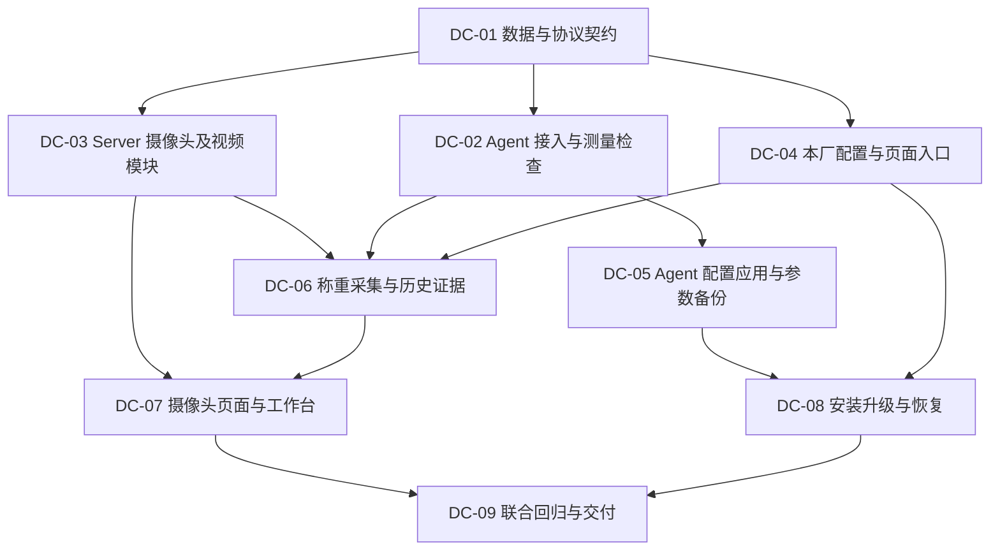

> **已交付工作包的计划档案（2026-10-25）**：DC-01～DC-09 软件交付已登记，本文保留原依赖与设计检查清单，不作为下一轮重做指令。实际剩余工作与验收见[当前状态](../../next.md)，实际实现见[交付记录](../../requirements/local-device-maintenance-delivery.md)。

# 单厂设备与配置简化：实施拆分

2026-10-24。依据：[设备规格](../../requirements/local-device-maintenance-spec.md)。本文只维护当前工作包、依赖和完成条件；实施及验证状态统一见[当前状态](../../next.md)。任务不是新的审批关卡，开发启动后按依赖自主推进。

## 1. 实施顺序与并行方式

先冻结本次必要契约，之后 Agent、Server 摄像头、配置页面三条线可并行。修改 `agentproto`、`agentbridge`、app 装配和公共 Web 类型时指定一个任务主写，其他任务通过已定接口接入，避免多个 Agent 同时改同一文件。部署与真实现场验收分别推进。

## 2. 工作包

| 工作包 | 范围及现有入口 | 依赖／验收 |
| --- | --- | --- |
| DC-01 数据与协议契约 | 确定无 key 的唯一地磅接入、测量开始／结束关联、设备实际配置反馈、相机对象／图片元数据和版本语义；新增相机、视频设置、备份等所需 Goose migration；保留本厂身份、历史图片和账本 | 先行；评审本规格 AC 对应的请求／回复及失败行为；明确旧客户端不支持时的错误和协同升级步骤 |
| DC-02 Agent 接入与测量检查 | `cmd/agent-printer`、`cmd/agent-mock`、`internal/agentscale`、`agentproto`／`agentbridge`；删除密钥／人工编号启动门槛，保留首连接互斥；固定仪表参数；每帧及故障锁存采集失效，原子开始／结束核实 | DC-01；AC-01/02/06；先写同批次“稳定100→101→100”行为回归，覆盖断连／重载／超时与迟到回复 |
| DC-03 Server 摄像头及视频模块 | 沿用 handler/service/repository/model 与 app 装配；从 `internal/agentcamera` 提取可复用取帧与识别实现，分离 Agent 凭据上传；DB CRUD、独立密码语义、6秒并发截止、测试、MediaMTX 托管路径与恢复同步 | DC-01；AC-04/05/07；取帧／外部识别／Control API 通过已有风格注入依赖，不新增泛化设备框架 |
| DC-04 本厂配置与页面入口 | `internal/sysconfig`、`weighing/site_config_*`、`local_setup.go`、`web/pages/system/configs`、导航与路由；标题从 YAML 保留迁出、本厂资料同页按原权限维护、旧链接归一，提供票面标题读取契约 | DC-01；AC-08；不更改账号、JWT、角色管理语义，不把整个通用配置权限授给只需本厂资料的人 |
| DC-05 Agent 应用与成功备份 | `internal/agentmaintenance`、Agent 配置读写与维护消息、`web/pages/agent-maintenance*`；只留串口／打印，一次提交，CUPS 枚举、上一成功回退；自动上报成功参数，Server 存恢复副本及时间，明确恢复 | DC-02/01；AC-03/09；实际生效但回执／备份失败时保留事实并允许核对，不自动覆盖 Agent |
| DC-06 称重编排与历史证据 | `weighing/workflow_service.go`、`workflow_repository.go`、`agentbridge/hub.go`／`images.go`、图片及票面读取；Server 编排测量窗口与取帧，测量代次持续到确认，按相机集合校验，保存策略／图片／新单标题快照并固化旧单显示基准 | DC-02/03，票面接 DC-04 契约；AC-05/06/10；不以 Server 缓存重量或浏览器图片替代本次证据，不跨网络持有设备状态锁 |
| DC-07 摄像头页面与工作台 | 独立摄像头页面、API/types、动态预览、核对和历史图片列表；逐台测试及时间、抓拍／预览分开反馈、识别源选择；移除 Agent 页相机与固定front/rear UI | DC-03/06；AC-04/07/08/10；先读 Web Pattern，覆盖0/1/3台、窄屏、只读权限和失败状态 |
| DC-08 安装升级与恢复 | `agent/deploy/install-local.sh`、打包及检查脚本、配置样例、`agent-provision` 与旧导出调用方；Server/Agent组件安装、Agent-only不需DB、FFmpeg落Server、旧env移除废字段；业务库／图片／账本保留 | DC-04/05，集成时接 DC-03/07；AC-09；安装测试只用临时目录／替身，不连接真实业务库或自动实物打印 |
| DC-09 联合回归与交付 | 受影响后端、PostgreSQL、Web、内嵌发布及安装检查；补充部署说明、协议文档、维护页Pattern、验收与实际交付状态 | DC-06/07/08；AC-01..10；逐项区分软件、模拟、部署与现场证据，不以旧阶段测试替代本次结论 |

## 3. 契约先行的具体清单

DC-01 必须产出能被各工作包直接使用的最小契约，冻结后不让其他工作包猜字段：

1. Agent 无密钥接入及 Server 分配本厂关联的响应，连接冲突／未初始化／能力不足的错误；更新 mock 的相同行为。
2. 测量开始确认、结束核实、取消与失效回复；当前连接及请求关联，串口每帧失效不可复活；测量代次跨取图窗口持续，确认时核实同一依据；能力／协议修订方式及不兼容升级顺序。
3. 摄像头 CRUD、秘密留空保持／显式清除、相机 ID／名称、抓拍用途、配置版本；视频服务设置、托管路径所有权和独立同步结果。
4. Agent 生效配置反馈、CUPS 队列列表、参数备份时间／摘要和明确恢复；只读备份不接受普通配置编辑。
5. 新图片对象、历史 front/rear 读取兼容、逐台结果与来源快照；既有业务 API 及用户权限契约的兼容适配。

路径及字段命名由实现沿用项目风格决定；不得借契约设计恢复中心／多节点运行模式、增加通用注册平台或并行保留两套可编辑配置。

## 4. 升级和验证重点

- 不使用 ADR 0028 当时“清空旧业务库”的切换方式。本次是在现有单厂库上新增迁移，保留业务、身份、图片与授权。旧配对身份不再阻止接入，其业务引用通过内部关联迁移，不先删表破坏历史。
- Agent旧相机文件可能只有MediaMTX转出地址，没有真实源凭据；不能自动猜测。需要导入／重新填写源的场景在升级提示与文档中明确，不静默重置设备数据。
- 打印账本现以Server URL等值隔离。取消手工身份与修改URL时，迁移或内部关联必须保护原尝试，不因换地址得到空去重空间；切换其他业务实例仍隔离。
- MediaMTX API配置不等同于部署文件持久化。测试远端重启、文件重载、断连后恢复，以及离线删除后的托管路径清理；不改动其他应用的流。
- 标题配置不能只插入seed：现有内置配置修改只放行特定布尔键，需增加受保护文本键的修改校验。新单保存标题快照；旧单按升级时可得有效标题固化基准，不能靠“不更新旧记录”声称旧票面不变。
- 固定吨制、取消启用等字段时检查env解析、命令行、示例、摘要和维护校验是否仍暗含旧字段；旧文件升级后可启动，不能靠保留隐藏参数规避新要求。
- 软件回归优先围绕采集／确认、配置应用、恢复及图片读取的公开行为；用临时串口、模拟RTSP和隔离PostgreSQL替代真实业务资源。只有现场才能验证的权限重启、非零重量／稳定灯、真实相机及连续纸逐项留待实测。

完成任务时在交付记录写明代码范围及实际验证证据，再更新[当前状态](../../next.md)。文档整理或工作区出现代码均不等于工作包已验收。
