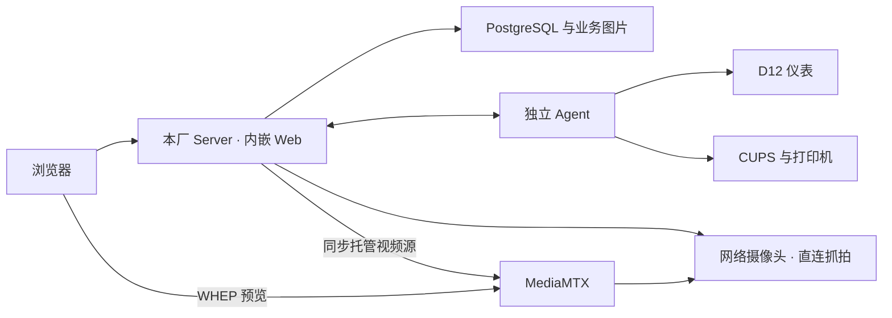

# 单一本厂系统：当前总规格

2026-10-25 收敛版。本文定义已确认的最终目标；业务细则见[业务规则](weighing-business-spec.md)，设备及配置细则见[设备维护规格](local-device-maintenance-spec.md)。实现、软件验证和现场验收分别见[当前状态](../next.md)，不能由需求已确认推定完成。决策理由按需查[ADR 索引](../adr/README.md)。

## 产品范围与职责

每厂独立部署本地 Server（内嵌 Web）、独立 Agent 和 PostgreSQL，当前每厂一台地磅。默认同机，支持同厂局域网分机；安装组件的选择不产生新的运行角色。本地账号、权限、基础资料、称重、单据、打印、查询与导出形成完整闭环；本厂只办理、查询本厂业务。

| 组成 | 目标职责 |
| --- | --- |
| Server | 用户与业务授权、基础资料、称重校验、权威记录及单据；网络摄像头配置、直连 RTSP 取图、可选外部识别、MediaMTX 视频源同步；Agent 成功参数的恢复副本 |
| Agent | 独占本机仪表串口、持续核实测量依据、打印及账本；持有串口与打印有效参数，执行网页发来的维护请求 |
| PostgreSQL／图片目录 | 分别保存业务与配置数据、图片文件；两者及其关联均纳入备份 |
| CUPS／MediaMTX | CUPS 位于打印 Agent 主机；MediaMTX 可独立部署，负责浏览器 WHEP 预览。Server 正式抓拍直接访问相机，不依赖预览服务 |

全系统只有一种本厂运行形态。中心、跨厂管理、同步、统一账号资料、审批及配置下发不属于当前产品；旧 `center/site/standalone` 和空角色模式不再兼容。未来中心能力须重新确认范围。host-collector 为可选宿主机监控，与设备 Agent 分工不同。

## 本厂身份、初始化与管理

- 本厂未配置时 API 仍可启动，允许登录管理；正式业务须先完成本厂初始化。网页首次只填厂区名称与地磅名称；内部身份与编号由系统管理，一次成功后固定，名称可维护。初始化保持事务、并发保护、失败回滚及重复请求拒绝，无需重启。
- 本厂身份和地磅保存成功即初始化完成，不设置操作员人数或姓名填写门槛。`configured` 与 `initialized` 同时表达配置完成，不表示设备就绪；兼容已有配置但旧启用标记为 0 的本厂，状态查询不修改启用标记。
- 继续使用 `wb_local_identity` 单例及既有本厂／地磅业务表；首次接口沿用 `POST /api/weighing/site-config/initialize`，本厂状态沿用 `GET /api/weighing/local-status` 的 `{siteId, configured, initialized}`，capabilities 保留 `localSiteId`、`configured`、`initialized`，不提供 `nodeRole`。
- 原初始化接口的兼容输入保持：`siteId` 在 1..255 时可作为编号前缀，`code`、`scaleCode`、`agentId`、`serverUrl` 不作为用户配置生效。设备内部关联的迁移不得破坏历史业务引用；不重新建立人工编号或配对门槛。
- 本厂资料与单据标题、强制抓拍集中在“系统管理 → 配置管理”，各分组沿用原权限。本厂身份仍写原业务表，标题和业务开关使用通用配置；旧链接可指向唯一入口，不维护两套表单。
- 谁能操作继续由既有 JWT、RBAC、账号启用状态和本厂操作范围决定。保留操作员姓名及实际操作人追溯，不因初始化简化自动授予业务权限。
- 各厂有权限人员独立维护资料、账号和授权；新资料直接按本地权限建档。取消跨厂选择、跨厂筛选、新增厂区和中心审批入口，后台同样实施本地范围约束。

## 业务与故障边界

正式称重须有当次设备依据、操作员明确确认及 Server 校验。抓拍默认强制，本厂管理员可关闭并保存无图事实；具体规则统一见[业务规格](weighing-business-spec.md)。稳定、识别成功或设备接入都不能代替用户确认。

互联网中断且本地服务、数据库及设备链路正常时可以办理；本地业务或仪表链路故障不能用浏览器缓存、手输原始重量绕过。提交结果未知先查原请求，打印结果未知先核实；重连、重启及恢复不自动补称、补图、重出单或重打。

## 设备维护与发布

- Agent 只填从其主机可访问的 Server 地址；按本厂局域网互信接入唯一地磅，同磅真实 Agent 与 mock 互斥、先连接者保持。登录、用户权限和维护审计继续保留。
- 维护复用业务地址、账号及现有通信通道。Agent 主进程与维护通信常驻；网页控制设备执行，仪表与打印参数一次“保存并应用”。进程离线由宿主机 systemd／日志恢复，网页明确显示无法远程维护。
- 正常安装、升级由工具生成配置；Server 启动参数仍在本地文件。支持同机、Server-only、Agent-only，Agent-only 不要求数据库凭据。生产 Web 随 Server 发布，不需要 Vite／Node 常驻。
- 统一版本发布包、安装、启停、升级及恢复说明；串口、CUPS 授权采用实际运行账号所需权限，敏感配置脱敏，维护操作留审计。旧独立维护服务及密码入口须在统一维护通过验收后退役。
- Server 自动备份 Agent 最近成功生效参数，恢复由人员明确发起；参数备份不等于业务系统灾难恢复。详细字段、失败处理和升级边界见[设备维护规格](local-device-maintenance-spec.md)。

## 数据与范围边界

本次设备及配置改造在现有单厂数据库上新增 Goose migration，保留业务身份、记录、图片、现场有效参数、授权及打印账本；API 启动不 AutoMigrate，保留历史 PostgreSQL schema／seed migration。开发、数据库集成测试和生产仅使用 PostgreSQL。

早先退出多模式时的清库是已记录的一次性历史切换，不是当前升级步骤。现有单厂库不重复清空，不把旧清库授权当作本次授权。保留跨厂不冲突的记录编号，恢复不复用已发编号，也不自动重放物理打印。

暂缓完整 Server 灾难恢复、单盘保护的具体方案与恢复指标；保留保护目标，不以普通备份或参数恢复宣称已解决。当前不扩展道闸、无人值守、库存、采购销售结算、ERP、扣水扣杂、多物料多货主拆单、内置识别引擎或新部署框架。

## 完成判定

| 验收面 | 可观察条件 |
| --- | --- |
| 本厂与业务 | 从未配置到初始化、权限、双方向称重、历史快照、幂等、异常处置、单据和查询闭环正确；详见业务规格 B-01～B-08 |
| 设备及配置 | 接入、仪表、相机、测量有效性、维护、标题、安装恢复全部满足设备规格 AC-01～AC-10 |
| 本地发布 | 同机及分机可运行；断互联网不影响本地链路；重启、升级及恢复保留数据、图片、配置和账本；未知操作不重放 |
| 现场 | D12 非零与稳定灯、重启串口权限、真实相机／识别、连续五联纸和完整业务闭环分别有实际记录 |

当前剩余工作和完成状态统一维护在[状态入口](../next.md)，已交付改造的工程依赖保存在[工作包档案](../history/requirements/local-device-maintenance-plan.md)。软件、隔离模拟、分机演练及现场结果分别记录；旧版验证不能覆盖新协议和新职责。检查入口遵循[开发指导](../../CLAUDE.md)，不要求重复执行已通过的等价检查。
