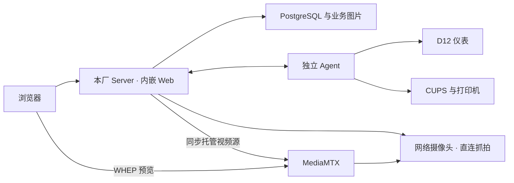

# 单一本厂系统：当前总规格

2026-10-26 修订：成功采集后冻结依据。本文定义已确认的最终目标；业务细则见[业务规则](weighing-business-spec.md)，设备及配置细则见[设备维护规格](local-device-maintenance-spec.md)。实现、软件验证和现场验收分别见[当前状态](../next.md)，不能由需求已确认推定完成。决策理由按需查[ADR 索引](../adr/README.md)。

## 产品范围与职责

每厂独立部署本地 Server（内嵌 Web）、独立 Agent 和 PostgreSQL，当前每厂一台地磅。默认同机，支持同厂局域网分机；安装组件的选择不产生新的运行角色。本地账号、权限、基础资料、称重、单据、打印、查询与导出形成完整闭环；本厂只办理、查询本厂业务。

| 组成 | 目标职责 |
| --- | --- |
| Server | 用户与业务授权、基础资料、称重校验、权威记录及单据；网络摄像头配置、直连 RTSP 取图、可选外部识别、MediaMTX 视频源同步；Agent 成功参数的恢复副本 |
| Agent | 独占本机仪表串口、持续核实测量依据、打印及账本；持有串口与打印有效参数，执行网页发来的维护请求 |
| PostgreSQL／图片目录 | 分别保存业务与配置数据、图片文件；两者及其关联均纳入备份 |
| CUPS／MediaMTX | CUPS 位于打印 Agent 主机；MediaMTX 可独立部署，负责浏览器 WHEP 预览。Server 正式抓拍直接访问相机，不依赖预览服务 |

本厂系统保留单机自治能力；本次各厂正式投入使用时即接入云端，使用前先完成厂区绑定和首次总部资料同步。接入后总部统一维护并下发基础资料，本地上传已出过磅单，互联网中断不阻塞正常本厂业务；业务范围见[业务规格](weighing-business-spec.md)，双方同步边界见[厂云同步契约](cloud-sync-contract.md)。目前各厂尚未开始使用，本次上线不存在历史导入；新版编码归属资料同步和单据变化上传已实现，验证与现场验收范围见当前状态。旧 `center/site/standalone` 和空角色模式不恢复兼容。host-collector 为可选宿主机监控，与设备 Agent 分工不同。

## 本厂身份、初始化与管理

- 安装时在“系统管理 → 本厂身份”填写总部或实施方预先分配的厂区编码，地磅编码默认 `WB01`；编码和名称可维护。云端按厂区编码校验并归属同步数据，不使用凭据或地磅编码；编码允许修改，历史数据与待上传变化规则见厂云同步契约。资料同步和单据上传使用版本 2；验证与现场验收范围见当前状态。四项身份数据存于受保护的系统配置项，不通过通用配置入口绕过业务校验。
- 每套数据库只属于本厂唯一地磅，本地业务、授权与历史证据不以当前厂区或地磅编码判断归属；任务、称重、单据及图片之间的业务关联继续保留。历史单号和当时身份快照不改写，新出单使用当前厂区编码。操作会话、已冻结采样、旧图片和打印防重在改码后保持可追溯。Agent 由 Server 提供当前编码，无需手工填写；详情及迁移边界见 [ADR 0034](../adr/0034-editable-local-identity.md)。
- 身份确定前不办理正式业务；初始化保持事务、并发保护和失败回滚，不执行 schema migration 或 AutoMigrate。配置完成不表示设备就绪。空库初始化保留 seed 管理员的初始本厂操作范围，不改角色动作权限，不自动授权其他账号。
- 本次部署从空数据库初始化，不要求导入原有业务数据、授权及设备配置；不自动清理任何已有数据库。新装库在本厂身份页面填写总部预分配编码；上线后须保留业务记录、图片、授权及历史身份快照，备份恢复后保持可追溯。
- “系统管理”下的独立维护页面分别维护本厂与地磅信息、流水号水位和过磅单标题，支持编辑与样张预览，缺省“酒厂过磅单”；标题与强制抓拍使用原通用配置及权限。预览不生成单据或打印，标题修改只影响后续生成的单据，历史查看与补打沿用保存的标题。原“本厂称重”页退役，旧链接转到后台查询；旧本厂配置链接指向本厂身份页面。
- 谁能操作继续由既有 JWT、RBAC、账号启用状态和本厂操作范围决定。保留操作员姓名及实际操作人追溯，不因初始化简化自动授予业务权限。
- 内置操作员角色默认提供单据查询、基础资料、日志管理、系统概览和称重工作台五类菜单，隐藏其他菜单；日志管理包含登录日志和操作日志，沿用既有权限。操作员无指定返回地址登录或访问首页时默认进入本厂称重工作台，自动核对唯一启用地磅及操作授权；其他用户（含兼具 `ADMIN` 的账号）默认进入系统概览，有效站内返回地址继续保留。菜单显隐不替代 API 授权，概览各区域仍按真实权限加载。
- 单机阶段各厂有权限人员独立维护资料、账号和授权，内置操作员角色默认拥有资料维护权限；接入云端后基础资料由总部维护并同步到本厂，取消操作员本地维护菜单，本地资料只通过云端同步更新。账号和授权沿用本地规则；单机已有资料接入云端时由人工分析合并，不开发自动分析、合并或匹配功能，具体切换操作待确定。取消跨厂选择、跨厂筛选、新增厂区和中心审批入口，后台同样实施本地范围约束。

## 系统概览

- 概览只展示本厂真实业务及有依据的设备状态，标题为“系统概览”；不使用访问量、用户增长、可用率及模拟趋势等演示数据。
- 今日有效单按北京时间出单日期、查询时仍有效的单据计数；入厂卸货与出厂装货分别汇总最终净重及趟数。作废版本不计入，重开只计当前有效单，暂不引入客户尚未确认的结算日期。
- 当前待回磅覆盖全部日期，另计首次称重早于今日零点的隔日任务。展示按首次称重时间从早到晚的前 5 趟及最近 5 张有效单，链接到原任务／单据查询与详情。隔日属于正常业务状态。
- 页面顶部仅保留刷新按钮，不展示可视标题、说明和统计时间行。设备摘要采用紧凑网格，与同排待回磅卡片等高，展示仪表、打印、抓拍策略与摄像头配置、预览同步的最近已知状态，底部保留读取时间并移除维护快捷入口；请求失败显示未知。摄像头配置及预览映射不能证明相机当前在线，概览刷新不执行抓拍、维护、称重或打印。
- 概览沿用业务查询、设备维护及摄像头查看权限，各区域独立加载及失败处理；没有权限时不请求对应数据。空数据为零，失败不以零或旧数据冒充当前结果。

## 业务与故障边界

正式称重须有当次设备依据、操作员明确确认及 Server 校验。抓拍默认强制，本厂管理员可关闭并保存无图事实；具体规则统一见[业务规格](weighing-business-spec.md)。稳定、识别成功或设备接入都不能代替用户确认。

互联网中断且本地服务、数据库及设备链路正常时可以办理；本地业务或仪表链路故障不能用浏览器缓存、手输原始重量伪造新采集；成功采集后的结果已冻结，Server 与数据库可用时可继续人工确认，不要求仪表持续在线。提交结果未知先查原请求，打印结果未知先核实；重连、重启及恢复不自动补称、补图、重出单或重打。

## 设备维护与发布

- Agent 只填从其主机可访问的 Server 地址；按本厂局域网互信接入唯一地磅，同磅真实 Agent 与 mock 互斥、先连接者保持。登录、用户权限和维护审计继续保留。
- 维护复用业务地址、账号及现有通信通道。Agent 主进程与维护通信常驻；网页控制设备执行，仪表与打印参数一次“保存并应用”。进程离线由宿主机 systemd／日志恢复，网页明确显示无法远程维护。
- 正常安装、升级由工具生成配置；Server 启动参数仍在本地文件。支持同机、Server-only、Agent-only，Agent-only 不要求数据库凭据。生产 Web 随 Server 发布，不需要 Vite／Node 常驻。
- 统一版本发布包、安装、启停、升级及恢复说明；串口、CUPS 授权采用实际运行账号所需权限，敏感配置脱敏，维护操作留审计。旧独立维护服务及密码入口须在统一维护通过验收后退役。
- Server 持久化最近生效状态供诊断；管理员在设备维护的“配置备份”页手动创建、查看、恢复和删除设备参数备份，保存应用、重连及恢复不自动新增备份；参数备份不等于业务系统灾难恢复。详细字段、失败处理和升级边界见[设备维护规格](local-device-maintenance-spec.md)。

## 数据与范围边界

本次设备及配置改造在现有单厂数据库上新增 Goose migration，保留业务身份、记录、图片、现场有效参数、授权及打印账本；API 启动不 AutoMigrate，保留历史 PostgreSQL schema／seed migration。开发、数据库集成测试和生产仅使用 PostgreSQL。

早先退出多模式时的清库是已记录的一次性历史切换，不是当前升级步骤。现有单厂库不重复清空，不把旧清库授权当作本次授权。保留已发记录编号和历史关联，恢复不自动重放物理打印；恢复后编号倒退的处理暂缓决策，过磅单号改为“厂区编码-北京时间出单日期-当日流水号”，由本地序列原子分配，容量与恢复后防重复方案见[业务规格](weighing-business-spec.md)及 ADR 0033。

暂缓完整 Server 灾难恢复、单盘保护的具体方案与恢复指标；保留保护目标，不以普通备份或参数恢复宣称已解决。当前不扩展道闸、无人值守、库存、采购销售结算、ERP、扣水扣杂、多物料多货主拆单、内置识别引擎或新部署框架。

## 完成判定

| 验收面 | 可观察条件 |
| --- | --- |
| 本厂与业务 | 从未配置到初始化、权限、双方向称重、历史快照、幂等、异常处置、单据和查询闭环正确；详见业务规格 B-01～B-08 |
| 设备及配置 | 接入、仪表、相机、测量有效性、维护、标题、安装恢复全部满足设备规格 AC-01～AC-10 |
| 本地发布 | 同机及分机可运行；断互联网不影响本地链路；重启、升级及恢复保留数据、图片、配置和账本；未知操作不重放 |
| 现场 | D12 非零与稳定灯、重启串口权限、真实相机／识别、连续五联纸和完整业务闭环分别有实际记录 |

当前剩余工作和完成状态统一维护在[状态入口](../next.md)，已交付改造的工程依赖保存在[工作包档案](../history/requirements/local-device-maintenance-plan.md)。软件、隔离模拟、分机演练及现场结果分别记录；旧版验证不能覆盖新协议和新职责。检查入口遵循[开发指导](../../CLAUDE.md)，不要求重复执行已通过的等价检查。
